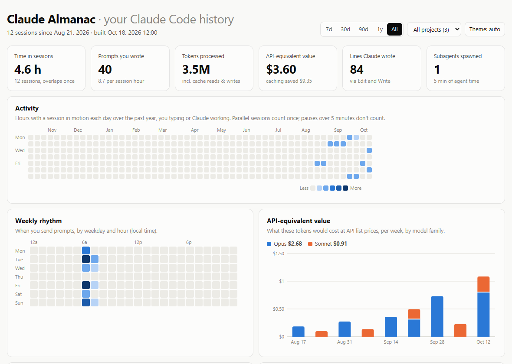

# Claude Almanac

A one-page dashboard of your own Claude Code history: how much you use it, when, on what, what it
would cost at API prices, and which prompts you keep repeating. It reads the session transcripts
Claude Code already keeps on your computer and writes a single HTML file. Nothing leaves your machine.



The screenshot is built from the invented transcripts in `tests/fixtures` (three made-up projects,
12 sessions), not from anyone's real history. The whole page is in
[`screenshots/dashboard-full.png`](screenshots/dashboard-full.png).

## What it does

- **Totals:** time in sessions (parallel sessions count once, pauses over five minutes do not),
  prompts you typed, tokens processed, lines Claude wrote, subagents spawned.
- **When you work:** a year of daily activity and a weekday-by-hour map of when you send prompts.
- **What it is worth:** the tokens converted to an API-price estimate per week and model family, and
  how much prompt caching saved. It is an estimate at list prices, not what you paid.
- **What Claude does:** tools, skills, subagents, shell commands, slash commands, MCP servers and the
  files it edited most.
- **Habits:** longest streak, busiest day, peak hour, how often a tool call errored, how often you
  pressed Esc, and the replies you type most.
- **Session explorer:** search every prompt you have written, open a session, and copy the command to
  resume it.
- Filter everything by 7 days to all time, or by project. Light and dark themes.

## How to run it

You need Python 3 (standard library only) and Claude Code history on the same machine.

```
python almanac.py                      # writes claude-almanac.html and opens it
python almanac.py --out report.html --no-open
```

It reads `~/.claude/projects` by default. Options:

- `--projects-dir DIR` read transcripts from another folder
- `--out FILE` where to write the page (default `claude-almanac.html`)
- `--no-open` do not open the page when done
- `--now 2026-10-18T12:00:00` pin "today" and the build time, so the same input gives the same bytes

To see it without any history of your own, build the sample dashboard:

```
python almanac.py --projects-dir tests/fixtures/transcripts --now 2026-10-18T12:00:00 --out sample.html
```

The page contains the text of your prompts, so treat the generated file as private.

## How it works

`almanac.py` is one Python file using only the standard library; `almanac_template.html` is the page
it fills in.

- **Reading.** Claude Code keeps each session as a JSON Lines file under
  `~/.claude/projects/<project>/`, with its subagent runs in a folder beside it. The script finds every
  transcript and parses them in parallel with a process pool. Each worker only extracts raw facts:
  assistant messages with their model and token usage, tool calls, typed prompts, slash commands,
  interruptions and failed tool results.
- **Counting each thing once.** Resuming or forking a session copies earlier messages into a new
  file. The results are merged main transcripts first, oldest first, and every message id, tool-call
  id and prompt id is counted once, so the original copy wins.
- **Your words, not the plumbing.** User records also carry tool results, injected
  `<system-reminder>` context, slash-command markup and meta messages. Those are stripped or skipped,
  so the prompt search and "replies you type most" see only what a person typed.
- **Active time.** Each event keeps a session active until the next one, for at most five minutes.
  The active spans are stored per session and merged across sessions in the page, so two sessions
  running side by side count once.
- **Cost.** Each message is priced by its model from a table of list prices (input, output,
  5-minute and 1-hour cache writes, cache reads), with a per-family fallback for unknown models.
  Pricing the same tokens as if nothing were cached gives the "caching saved" figure.
- **The page.** The data goes into the template as one JSON blob, escaped so that `</script>` or a
  line separator inside a prompt cannot break out of the script tag. Everything else happens in the
  browser in plain JavaScript with no libraries and no network: filtering by range and project,
  re-aggregating, and drawing the heatmaps and the stacked spend chart as hand-built SVG.

**Tests.** `python -m pytest` runs 7 tests against invented transcripts made by
`tests/fixtures/generate_transcripts.py` (three projects, 12 sessions, one subagent run, one forked
duplicate). They check that two builds are byte-identical, that the forked message is counted once,
that the sample exercises every panel, and that building under UTC+11 and UTC-11 gives the same data:
every sample event falls around midday UTC, so the calendar day is the same in both.

## Related

- [Eyes](https://github.com/cmullis1/eyes) lets Claude Code look at and play what it builds.
- [Claude Code helpers](https://github.com/cmullis1/claude-code-helpers): Recall searches past
  sessions, Tune-up stops repeated Windows-specific mistakes.

Built with Claude Code.

## License

MIT, see [LICENSE](LICENSE).
